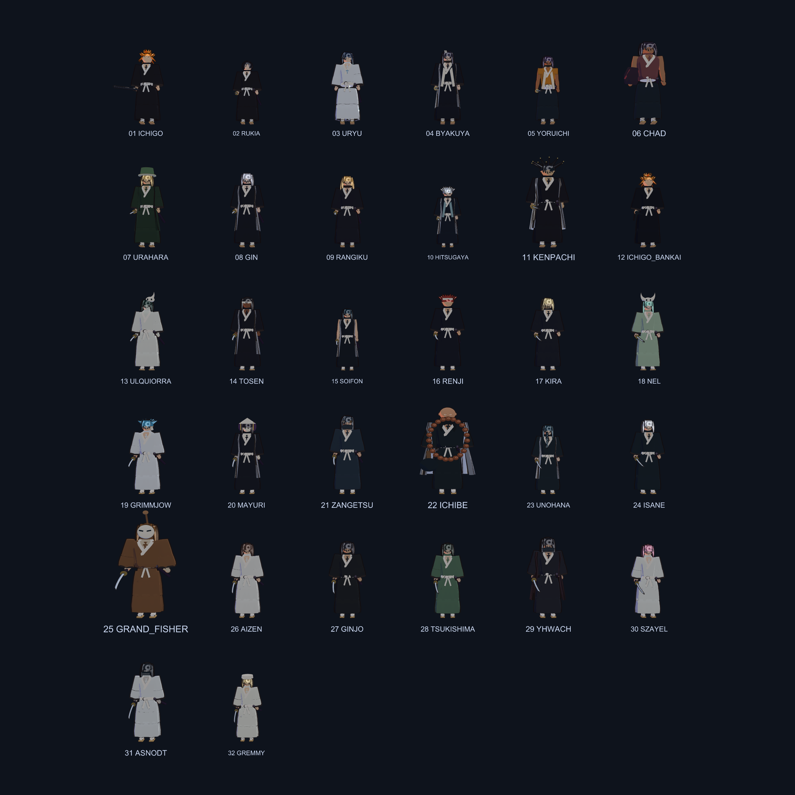
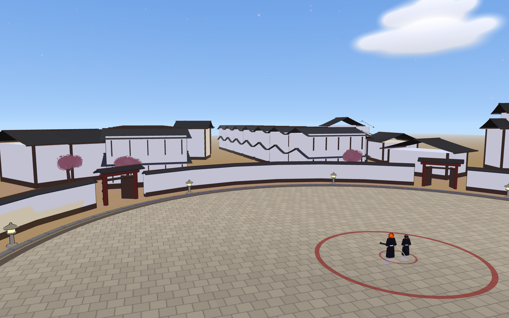
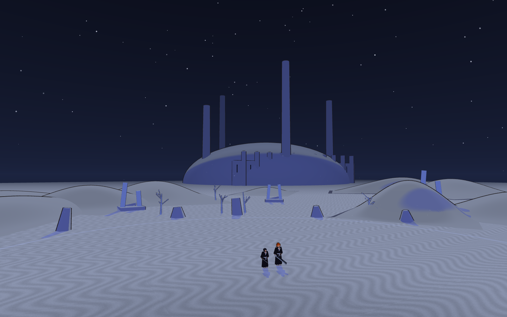

# 重製與主線製作紀錄

本分支是可執行的研究版，包含 **32 個造型初版、5 個場景、6 篇章 21 場改編對戰**。目前的程序化模型、表情和場景細節仍明顯低於《BLEACH 魂魄覺醒》，尚未達到完美複製或同等美術品質。

## 已實作與未完成的界線

- 圖片合輯的 20 個造型，加上斬月大叔、一兵衛、卯之花烈、虎徹勇音，共 24 個造型；白髮圍巾參考按日番谷處理。
- 另外建立 8 個主線對手初版：Grand Fisher、藍染、銀城、月島、友哈巴赫、薩爾阿波羅、艾斯・諾特、葛雷密。
- 每個造型有不同的髮型、配色或配件；仍共用基本人體、關節與近戰／鬼道。眼鏡、面具、靈弓、念珠等只是第一輪外觀研究。
- 靈弓與毛筆目前是外觀，尚未實作角色原作能力、變身、臉部骨架、口型、招式動畫、過場、配音和完整劇情演出。
- 場景為重新編排的研究用佈局，沒有擷取官方遊戲模型或貼圖，也不是官方地圖的逐項重建。

## 閱讀程式的順序

1. `Assets/Scripts/ArtMeshes.cs`：衣褶網格、開襟羽織、曲簷屋頂、花簇和沙丘。
2. `FighterModel.cs`、`CharacterArt.cs`、`FaceTex.cs`：關節、頭髮、配件、臉部貼圖和資源回收。
3. `RosterCatalog.cs`：角色名單與初始數值。戰鬥技能仍是訓練班共用系統。
4. `Arena.cs`、`Arena.Story.cs`：瀞靈廷、虛圈、空座町、靈王宮、地獄門前。
5. `StoryCampaign.cs`：篇章、對戰、戰前簡介、難度曲線與以穩定關卡 ID 儲存的進度。
6. `GameManager.Story.cs`：主線選關、戰前說明、開始／重試／下一關。
7. `Assets/Editor/ArtPreview.cs`、`GameChecks.cs`：可重跑的預覽與規則驗證。

## 第一步：重做造型與場景基礎

原本在袴上加細長方塊只能模擬線條；現在用不同高度的環形截面建立布料，讓褶皺從腰部逐漸變深。袖口改成向內收的薄邊，避免封死的圓盤。頭部加入鼻樑與臉頰變形，一護縮短髮束，斬月分成深色刀背與亮色刃口。

瀞靈廷的屋頂由尖錐改成長屋脊與翹簷曲面，補上街屋、門扇與石邊。櫻花以花簇取代球形樹冠。虛圈改用貼地的平滑沙丘，增加中景遺構，延長霧距離以看見虛夜宮。其餘三個場景是供主線使用的初版。

## 第二步：主線流程

| 篇章 | 關數 | 代表對戰 |
| --- | ---: | --- |
| 代理死神篇 | 3 | 一護 vs Grand Fisher、浦原、戀次 |
| 屍魂界篇 | 4 | 一護 vs 戀次／劍八／白哉；雨龍 vs 涅 |
| 破面篇 | 5 | 一護 vs 葛力姆喬、市丸銀、烏爾奇奧拉、藍染 |
| 代理死神消失篇 | 3 | 一護 vs 銀城；白哉 vs 月島 |
| 千年血戰篇 | 5 | 白哉 vs 艾斯・諾特；劍八 vs 葛雷密；一兵衛／一護 vs 友哈巴赫 |
| 獄頤鳴鳴篇 | 1 | 一護 vs 薩爾阿波羅的短篇遭遇戰 |

關卡只是經典對戰的選編，不是每一話的完整遊戲化。部分原作敗戰改成玩家可過關的挑戰，不代表改寫後的勝負是原作劇情。紀念短篇不補寫未交代的結局。戰前文字為簡短自行撰寫的關卡說明，沒有搬入漫畫對白或官方影片。

前 4 關使用 easy AI，第 5–15 關使用 normal，後 6 關使用 hard。第 n 關（n 從 0 起）的敵方體力倍率為 `1 + 0.025n`，近戰與鬼道倍率為 `0.8 + 0.025n`，速度倍率為 `0.9 + 0.01n`。數值作用在角色副本，不會永久修改對戰模式的角色。

勝利只解鎖下一關，失敗可直接重試；已通關關卡可重玩。以 `kido.story.v1` 儲存本機進度。自動驗證使用不寫入存檔的測試進度。

## 第三步：設計與效能改善

- 語音分析改成逐份辨識文字快取：同樣的文字不再每幀重算全鬼道比對；招式清單變更、取消詠唱會使快取失效。
- 動畫每個角色保留一份可寫姿勢，跑步、連擊和束縛不再反覆建立 Pose 與旋轉陣列。
- 頭像在選單逐幀產生，避免啟動時一次建立所有 32 隻角色；開始對戰前確保雙方頭像已建立。
- 切換角色與對戰結束時回收專屬網格、臉部貼圖和材質，保留共用網格與共用卡通材質。
- 比賽倒數使用實際經過時間，不受物理步長上限拖慢；低幀率時動作模擬本身仍有步長限制，未改成完整固定步長架構。
- 鏡頭依視角與螢幕比例計算容納雙方的距離，修正原本最大距離 22 公尺造成的裁切。
- 練習模式加入 R 立即重置戰鬥與站位。
- 免費「測試」招式限設定與練習使用，避免主線與對戰可無限施放零成本攻擊。

沒有宣稱特定 FPS 提升。Mono 的配置位元組計數器在本機回傳零，因此只記錄快取命中、姿勢重用與流程測試，不把零當成配置量測結果。

## 重跑驗證

使用 Unity 2022.3.50f1。在專案根目錄開啟 PowerShell：

```powershell
& 'C:\Program Files\Unity\Hub\Editor\2022.3.50f1\Editor\Unity.exe' -batchmode -quit -projectPath (Get-Location).Path -executeMethod ArtPreview.Export -logFile art-validation.log
```

也可在 Unity 選單執行 `Tools > Kido > Export art study`。預覽輸出到本目錄的 `previews/`。`GameChecks` 驗證關卡引用、解鎖、存檔往返、難度倍率、語音快取失效、倒數與遠距離鏡頭。它不會測試真人麥克風或人工操作手感。

`Tools > Kido > Build Windows study player` 產生 Development 研究版。用 `-kido-smoke` 啟動會自動跑主線／勝敗／重試流程並退出；正常啟動不執行自動流程。

## 實際預覽







## 參考與下一輪製作重點

美術參考：[Steam《BLEACH 魂魄覺醒》](https://store.steampowered.com/app/1689620/BLEACH/?l=tchinese) 與使用者提供的六張圖片。篇章分組與漫畫話數參考：[BLEACH 維基條目](https://zh.wikipedia.org/zh-tw/BLEACH)。對戰選編、數值與場景佈局是本專案的設計取捨。

要靠近參考圖的品質，仍須逐角手工雕塑頭型與髮片、重做人體與服裝拓撲、製作背面與側面細節、角色專屬武器／動作／能力，並逐場重建場景材質、建築細節與鏡頭。這些不能由目前的造型初版當作已完成。

隱藏視窗中的 UI 自動截圖回傳黑畫面，已排除，不作為介面視覺驗收證據。Windows 自動流程驗證僅證明狀態轉換；編輯器離線渲染預覽則已逐項查看。

## 可追溯的提交

- [`9e6b230`](https://github.com/Hung-NCKU/bleach/commit/9e6b230)：布料、屋頂與卡通光影基礎。
- [`6da5b2a`](https://github.com/Hung-NCKU/bleach/commit/6da5b2a)：32 個造型初版、5 個場景、主線、資源回收、語音／動畫／鏡頭改善與可重跑的驗證工具。

驗證記錄：[場景與角色](previews/validation.txt)、[遊戲規則](previews/game-checks.txt)、[Windows 狀態流程](previews/runtime-checks.txt)。2026-10-18 已成功建置 Unity 2022.3.50f1 Windows Development 研究版。隱藏視窗的 7 張純黑截圖已刪除；沒有將它們當成視覺通過證據。
